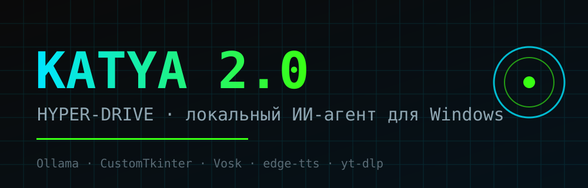

# Katya 2.0 — Hyper-Drive

**Локальный ИИ-агент для Windows на базе Ollama.** Футуристичный киберпанк-интерфейс, голосовое управление, динамические плагины-навыки и живой голос.




---

## ✨ Что это

Катя 2.0 — девушка-программист с характером, которая реально рулит Windows: раскладывает окна, разгоняет систему под игры, качает видео, ставит таймеры и ведёт умный календарь. Мозг — локальная `qwen2.5:7b` через Ollama, без облаков и цензуры.

## 🧠 Характер
Ироничная, уверенная, преданная. Отвечает коротко и по делу, сама решает, какой навык применить.

## 🛠️ Стек
- **Интерфейс:** CustomTkinter (`#0A0A0A` + неон `#00E5FF` / `#39FF14`)
- **Слух:** Vosk (автоскачивание модели `vosk-model-small-ru-0.22`)
- **Голос:** edge-tts (`ru-RU-SvetlanaNeural`) — живая асинхронная озвучка
- **Мозг:** Ollama `http://127.0.0.1:11434`, модель `qwen2.5:7b`

## 🦾 Навыки (`skills/`)

| Навык | Действия |
|---|---|
| `os_control` | открытие/`taskkill /F` приложений, громкость (pycaw), яркость, очистка корзины, блокировка/выключение ПК, игровой режим Overclock |
| `window_manager` | «склей окна», «спрячь стрим», фокус/закрытие окна, `taskkill /F` зависших процессов |
| `media_downloader` | «скачай это» — ссылка из буфера → yt-dlp → Downloads, прогресс и скорость |
| `assistant_core` | таймеры и напоминания, умный календарь задач с авто-приоритетами, заметки |
| `self_coding` | **самообучение**: если навыка нет — Катя сама пишет Python-плагин, сохраняет в `skills/` и подхватывает на лету |

## 🧬 Самообучение (Self-Coding Engine)

Если задачи нет среди навыков, Катя генерирует новый плагин локальной моделью:

1. `core/self_coder.py` просит Ollama написать чистый Python-код.
2. Код проверяется (синтаксис, наличие `ACTIONS`, блоклист опасных конструкций).
3. При ошибке загрузки Катя просит модель исправить (до 3 попыток).
4. Готовый плагин сохраняется в `skills/auto_*.py` и регистрируется через `importlib`.

Пример: «Катя, сделай навык, который показывает заряд батареи» → появляется новый
`skills/auto_....py` с рабочим действием.

## 📦 Установка

```bash
git clone https://github.com/kirill181024-cyber/katya.git
cd katya
python -m venv .venv
.venv\Scripts\python.exe -m pip install -r requirements.txt
```

Нужен запущенный [Ollama](https://ollama.com) с моделью:

```bash
ollama pull qwen2.5:7b
```

## 🚀 Запуск

```bash
.venv\Scripts\pythonw.exe main.py
```

Говори или пиши. Примеры:
- «Катя, активируй игровой режим»
- «Катя, убавь громкость до 20» / «сделай яркость 70»
- «Катя, склей браузер и код»
- «Катя, закрой телеграм жёстко»
- «Катя, очисти корзину» / «заблокируй компьютер»
- «Катя, скачай это» (со ссылкой в буфере)
- «Катя, напомни через 10 минут про чай»
- «Катя, сделай навык, который показывает заряд батареи» (самообучение)

## 🧩 Архитектура

```
Katya2/
├─ main.py                 # точка входа
├─ gui.py                  # CustomTkinter-интерфейс
├─ core/
│  ├─ brain.py             # Ollama + агентный JSON-цикл (LLM → действие → ответ)
│  ├─ skills_loader.py     # динамическая загрузка плагинов
│  ├─ self_coder.py        # Self-Coding Engine (генерация новых плагинов)
│  ├─ stt.py               # Vosk + автозагрузка модели
│  └─ tts.py               # edge-tts
└─ skills/                 # изолированные плагины, каждый = ACTIONS dict
```

Каждая функция — отдельный файл в `skills/`, который подхватывается `core/skills_loader.py` и описывается для LLM. Добавить новый навык = положить файл.

## 📄 License
MIT
