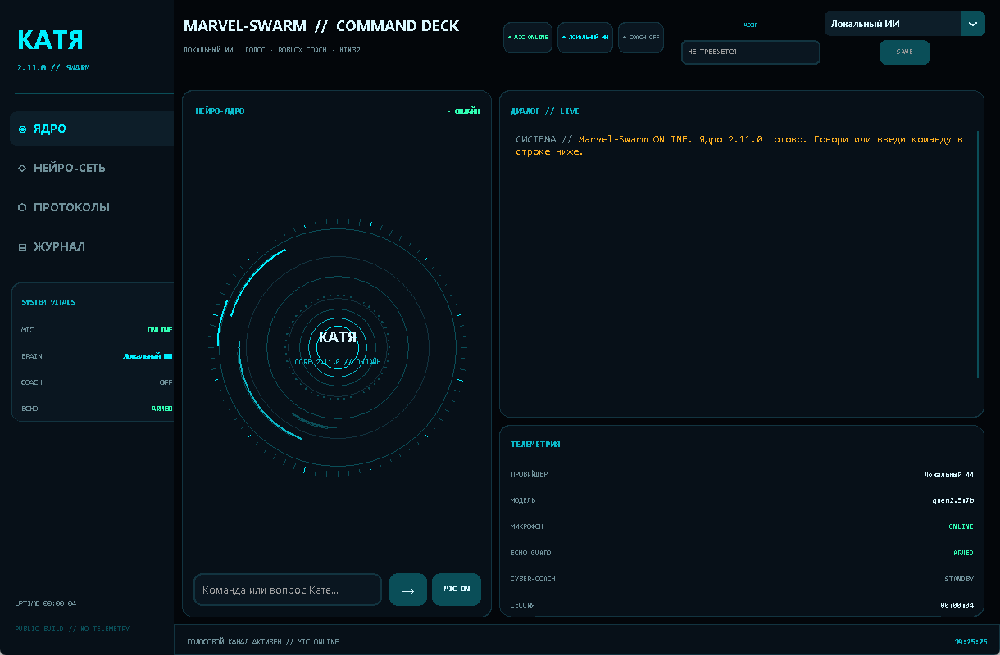
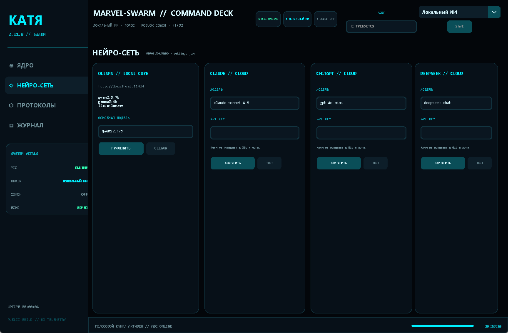
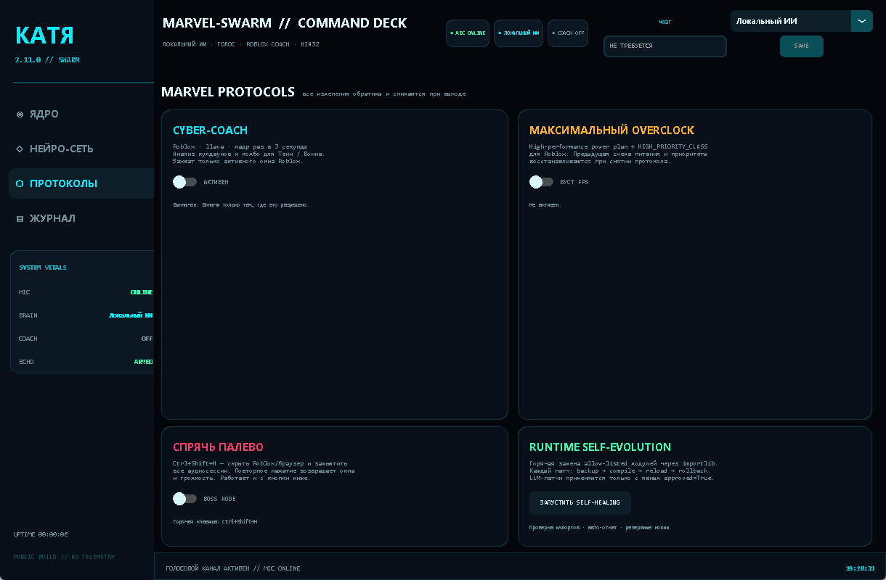

# КАТЯ 2.11.0 — Marvel-Swarm Edition

```
╔══════════════════════════════════════════════════════════════════╗
║   K A T Y A   //   2 . 1 1 . 0   //   M A R V E L - S W A R M   ║
║   локальный ИИ · русский голос · Roblox Cyber-Coach · Win32      ║
╚══════════════════════════════════════════════════════════════════╝
```

Голосовой ИИ-ассистент с футуристичным HUD в духе Пятницы из Marvel:
неоново-бирюзовый `#00F0FF`, глубокий чёрный фон, непрерывное фоновое
прослушивание, локальные модели Ollama и переключение «мозга» между
Локальным ИИ, Claude, ChatGPT и DeepSeek.

> **Платформа:** Windows 10/11. Python 3.10+.
> **Приватность:** по умолчанию всё считается локально. Облачные API
> используются только после того, как вы сами вставите ключ и выберете
> провайдера. Cyber-Coach захватывает **только активное окно Roblox**.



---

## Что нового в 2.11.0

- **Marvel-Swarm Core** — единый асинхронный движок: Tk-поток никогда не
  блокируется загрузкой модели, распознаванием, LLM или синтезом речи.
- **Постоянное фоновое прослушивание** — отдельный daemon-поток Vosk,
  работающий во время игр; интерфейс остаётся отзывчивым.
- **HUD «Пятница»** — анимированное нейро-ядро, телеметрия, LIVE-диалог,
  журнал, чипы состояния, неоновые панели.
- **Переключатель мозга в правом верхнем углу** — Локальный ИИ / Claude /
  ChatGPT / DeepSeek + поле API-ключа.
- **Hardware-Adaptive AI Setup** — psutil сканирует RAM: на 16 ГБ+
  ставится `qwen2.5:7b`, на меньшем объёме — `gemma3:4b`; тихая установка
  Ollama, прогресс-бар, загрузка `llava:latest` и русской модели Vosk.
- **Cyber-Coach** — mss-захват Roblox раз в 3 секунды, анализ кадров через
  `llava`, дерзкие голосовые советы по кулдаунам и комбо для Тени/Воина.
- **Echo Guard** — трёхуровневая отсечка собственного голоса: жёсткий гейт
  во время TTS, cooldown после, сравнение текстовых отпечатков.
- **Marvel Protocols** — обратимый FPS-overclock и Boss Key
  (`Ctrl+Shift+H`) через Win32 API + pycaw.
- **Runtime Self-Evolution** — горячая замена allow-listed модулей через
  `importlib` с backup → compile → reload → rollback; только с явным
  `approved=True`.
- **Self-Healing** — проверка импортов и авто-восстановление из резервных
  копий при старте.

---

## Структура проекта

```
Katya_2.11.0/
├── main.py                     # точка входа
├── config.py                   # конфигурация, пути, провайдеры
├── setup_wizard.py             # Hardware-Adaptive установщик
├── requirements.txt
├── ЗАПУСТИТЬ.bat               # запуск через venv
├── УСТАНОВИТЬ.bat              # venv + pip + мастер
├── core/
│   ├── brain.py                # Ollama / Claude / ChatGPT / DeepSeek
│   ├── engine.py               # неблокирующий голосовой конвейер
│   ├── stt.py                  # Vosk + автоскачивание русской модели
│   ├── tts.py                  # edge-tts DmitryNeural + fallback SAPI
│   └── echo_guard.py           # отсечка собственного голоса
├── ui/
│   └── interface.py            # HUD на CustomTkinter
├── skills/
│   ├── game_analyst.py         # Cyber-Coach (mss + llava)
│   └── marvel_protocols.py     # Overclock + Boss Key
├── tools/
│   └── publish_github.ps1      # безопасная публикация без токена в коде
├── tests/
│   └── test_smoke.py           # офлайн-проверки без GUI/сети
└── assets/
    └── screenshots/
        ├── core.png
        ├── neuro.png
        └── protocols.png
```

Настройки и модели **не лежат в репозитории**:

```
%LOCALAPPDATA%\Katya\
├── settings.json               # API-ключи и настройки (не коммитится)
├── models\vosk-model-small-ru-0.22\
├── cache\
├── backups\
└── logs\katya.log
```

---

## Установка

### Вариант 1 — одним bat-файлом

1. Установите Python 3.10+ (галочка **Add Python to PATH**).
2. Запустите `УСТАНОВИТЬ.bat`.
3. Дождитесь установки зависимостей и работы мастера.
4. Запустите `ЗАПУСТИТЬ.bat`.

### Вариант 2 — вручную

```powershell
cd Katya_2.11.0
py -3 -m venv .venv
.\.venv\Scripts\Activate.ps1
python -m pip install --upgrade pip
pip install -r requirements.txt

python setup_wizard.py     # Ollama + модель + Vosk
python main.py             # HUD
```

Проверка окружения без GUI:

```powershell
python main.py --check
```

### Ollama вручную

```powershell
ollama serve
ollama pull qwen2.5:7b     # 16+ ГБ RAM
ollama pull gemma3:4b      # меньше 16 ГБ
ollama pull llava:latest   # обязательно для Cyber-Coach
```

Ollama слушает `http://localhost:11434`.

---

## Горячие клавиши

| Клавиши | Действие |
|---|---|
| `Ctrl+Space` | прервать голос Кати |
| `Ctrl+L` | открыть журнал |
| `Ctrl+Enter` | отправить команду из строки ввода |
| `Ctrl+Shift+H` | Boss Key: скрыть окна + замьютить звук / вернуть обратно |

### Экранные панели





---

## Как пользоваться

1. Запустите `main.py`. Микрофон включается автоматически; статус
   `MIC ONLINE` — в шапке и боковой панели.
2. Говорите. Vosk распознаёт русскую речь локально, Катя отвечает голосом
   `ru-RU-DmitryNeural`.
3. «Мозг» переключается в правом верхнем углу. Для Claude/ChatGPT/DeepSeek
   вставьте API-ключ в поле рядом и нажмите **SAVE**. Ключ хранится только
   в `%LOCALAPPDATA%\Katya\settings.json`.
4. **Cyber-Coach** включается на странице «ПРОТОКОЛЫ». Он работает, только
   когда Roblox в фокусе, и отправляет кадр в `llava:latest` раз в 3 секунды.
5. **Overclock** повышает приоритет Roblox и включает схему питания
   High Performance. Повторное нажатие или выход из Кати возвращает всё
   обратно.
6. **Boss Key** скрывает Roblox/браузер и мьютит аудиосессии. Повторное
   нажатие восстанавливает окна и громкость.

---

## Безопасность и приватность

- **В коде нет токенов.** `config.py` читает `GITHUB_TOKEN` только из
  переменной окружения; API-ключи — из локального `settings.json`.
- **Не коммитьте `settings.json`, `data/`, `.env`.** Они уже в `.gitignore`.
- **Если токен когда-либо попал в чат, лог или коммит — отзовите его** в
  GitHub Settings → Developer settings → Personal access tokens. Считайте
  такой токен скомпрометированным.
- Cyber-Coach не читает память процесса Roblox, не внедряет DLL, не
  обходит античит и не автоматизирует ввод. Это только захват экрана и
  голосовая подсказка. Используйте там, где это разрешено правилами игры.
- Boss Key и Overclock меняют только обратимые пользовательские настройки:
  приоритет процесса, схему питания, видимость окон и громкость сессий.
  Никакой автозагрузки, скрытой персистентности или отключения защиты.
- Самоэволюция не применяет код от LLM автоматически. Патч требует
  `approved=True`, проходит `compile()` и при ошибке откатывается.

---

## Публикация на GitHub

Токен **не должен** находиться в `config.py`, `.git/config` или команде
`git remote add`. Используйте готовый скрипт, который берёт токен из
окружения и не печатает его:

```powershell
$env:GITHUB_TOKEN = "<fresh-token-with-repo-scope>"
.\tools\publish_github.ps1 -Owner kirill181024-cyber -Repo katya
```

Скрипт:

1. проверяет репозиторий через GitHub API;
2. создаёт его при отсутствии или принудительно переводит в **PUBLIC**;
3. делает `git init`, `git add .`, проверяет staged-файлы на утечки
   токенов/приватных ключей;
4. коммитит `Release v2.11.0…`;
5. делает force-push в `main`, используя временный `GIT_ASKPASS`;
6. проверяет, что репозиторий публичный.

> Для fine-grained token нужно право **Contents: Read and write** и
> **Administration: Read and write** (для смены видимости), либо classic
> token со scope `repo`.

---

## Диагностика

| Проблема | Решение |
|---|---|
| `Ollama недоступна` | Запустите `ollama serve`; проверьте `http://localhost:11434` |
| `Модель не найдена` | `ollama pull qwen2.5:7b` / `gemma3:4b` / `llava:latest` |
| Микрофон молчит | Windows → Конфиденциальность → Микрофон; выберите устройство в `settings.json` → `voice.input_device` |
| Нет русского голоса | Проверьте интернет для edge-tts; при сбое включается SAPI |
| Vosk качает модель при каждом старте | Проверьте права на `%LOCALAPPDATA%\Katya\models` |
| Cyber-Coach не видит игру | Roblox должен быть в фокусе; окно не свёрнуто; `llava:latest` загружена |
| `soundfile` не играет MP3 | Установите `ffmpeg` (fallback `ffplay`) |
| HUD не запускается | `python main.py --check`; смотрите `%LOCALAPPDATA%\Katya\logs\katya.log` |

---

## Лицензия

MIT. См. [LICENSE](LICENSE).

---

```
«Я не просто ассистент. Я — интерфейс между тобой и системой.»
                                                     КАТЯ 2.11.0
```
